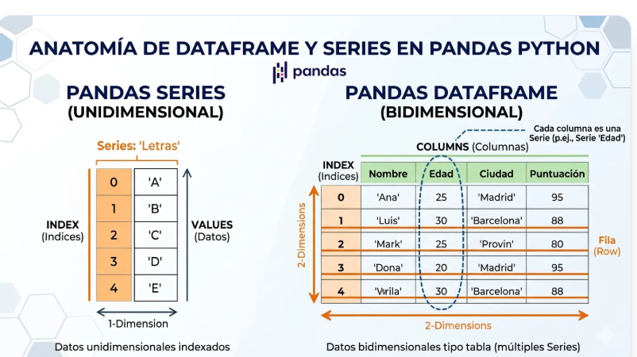
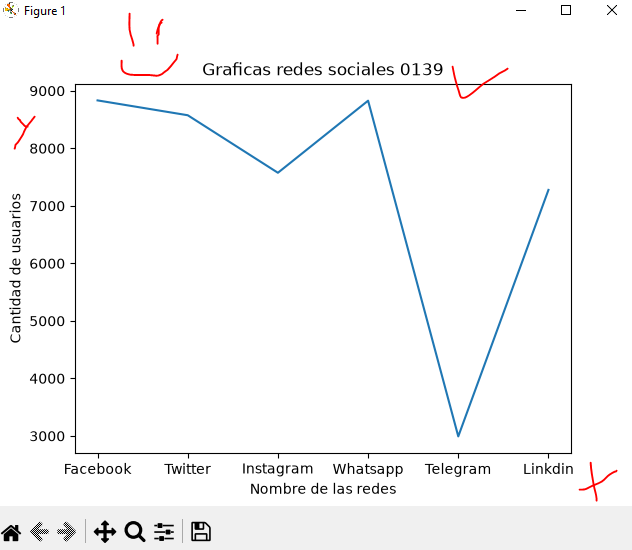
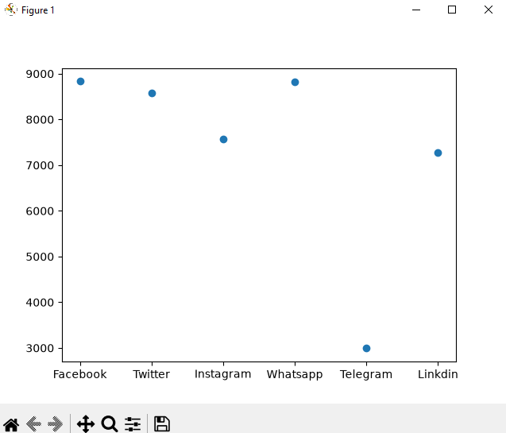
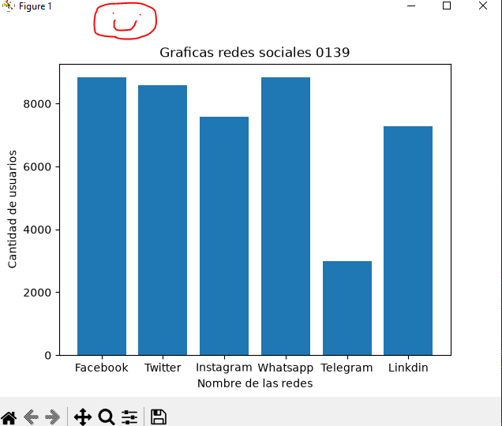
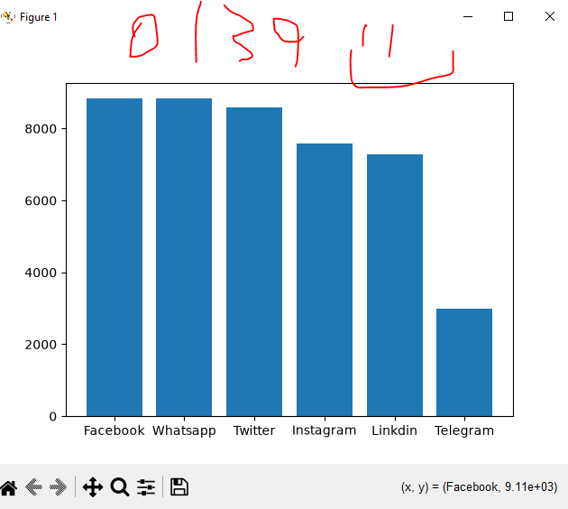
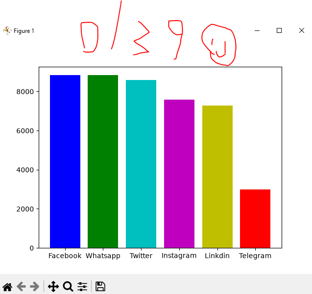
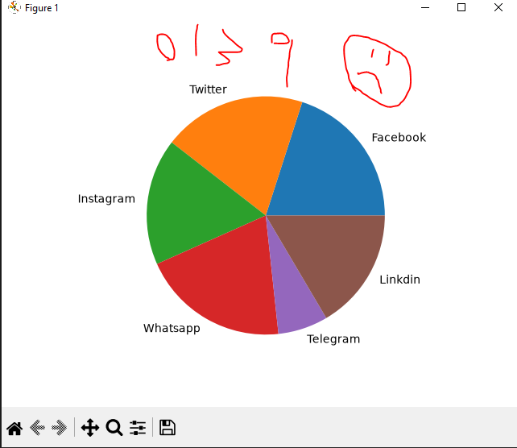

## dataframe o marco de datos en pandas

## redes sociales a nivel mundial

## Grafica lineal de redes sociales 

## grafica puntual de redes sociales

## grafica barra redes sociales

# grafica de barras redes sociales ordenada

##  grafica de barras redes sociales ordenada con colores

## Grafica de pastel de redes sociales
